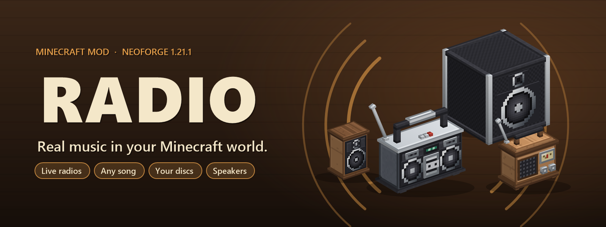

<p align="center"></p>

# Tamarou's Radio

A NeoForge 1.21.1 mod that adds radios you can actually listen to: web radios, any song you search for, your music discs, speakers and a portable radio. Everyone nearby hears the same thing at the same time.

Download it on CurseForge.

## Features

- **Search any song**, or paste a Spotify or Deezer link (track, album, playlist). Shared queue, repeat, shuffle, seek.
- **Live web radios** from the [radio-browser.info](https://www.radio-browser.info) directory, by country and genre.
- **Music discs** stored inside the radio, plus the game's own music.
- **Speakers** linked to a radio, all playing in sync.
- **Portable radio** with headphones and speaker modes.
- Two radio blocks (wooden radio and boombox), each with its own screen.

Song info and covers come from Deezer. The audio for searched songs comes from YouTube. Each player's game streams the music itself; the server only keeps everyone in sync.

## Building

Java 21 is required.

```
gradlew build
```

The mod jar is `build/libs/tamarous-radio-<version>.jar`. Libraries are bundled and relocated with Shadow.

`runSelftest` starts the game on a test world and runs an automatic check of every feature (see `client/SelfTest.java`).

## License

GPL-3.0-or-later, see [LICENSE](LICENSE).

Bundled libraries: [NewPipe Extractor](https://github.com/TeamNewPipe/NewPipeExtractor) (GPL-3.0), [Concentus](https://github.com/lostromb/concentus) (BSD), JLayer (LGPL), Rhino (MPL-2.0), jsoup (MIT), protobuf-javalite (BSD), nanojson (Apache-2.0).
